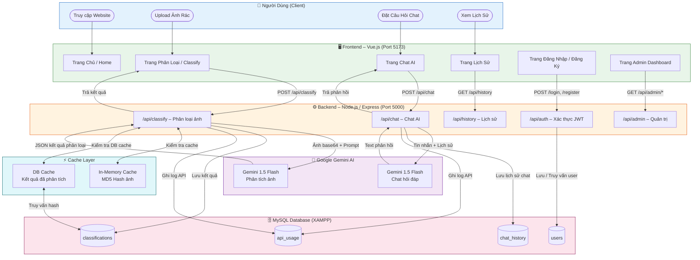

# PFD – Process Flow Diagram
# Hệ Thống Phân Loại Rác Thải Thông Minh (EcoScan)

> Mô tả luồng xử lý tổng quát của toàn bộ hệ thống theo từng tiến trình chính.

---

## Sơ Đồ PFD

---

## Mô Tả Các Tiến Trình Chính

| Tiến trình | Đầu vào | Xử lý | Đầu ra |
|---|---|---|---|
| **P1 – Xác thực** | Username/Password | Kiểm tra DB, tạo JWT | JWT Token |
| **P2 – Phân loại ảnh** | File ảnh | Hash → Cache → Gemini AI | JSON kết quả phân loại |
| **P3 – Chat AI** | Tin nhắn văn bản | Lịch sử chat → Gemini | Phản hồi văn bản |
| **P4 – Lưu lịch sử** | Kết quả phân loại | INSERT vào DB | Record trong DB |
| **P5 – Thống kê admin** | Query tổng hợp | SELECT aggregate từ DB | Báo cáo thống kê |

---

## Chú Thích

- **Cache 2 lớp**: In-memory (MD5) + DB cache theo `image_hash` để tránh gọi API trùng lặp
- **JWT Middleware**: Bảo vệ các route cần xác thực, route `/classify` hỗ trợ cả khách (guest)
- **Gemini 1.5 Flash**: Model duy nhất dùng cho cả phân loại ảnh lẫn chat
