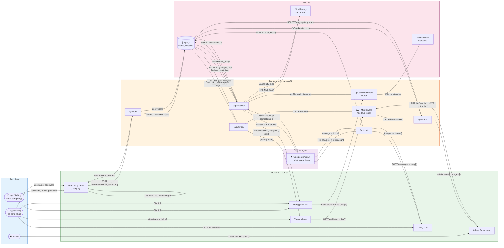

# IFD – Information Flow Diagram
# Hệ Thống Phân Loại Rác Thải Thông Minh (EcoScan)

> Mô tả luồng thông tin (dữ liệu) di chuyển giữa các thành phần trong hệ thống.

---

## Sơ Đồ IFD

---

## Bảng Luồng Thông Tin Chi Tiết

| STT | Từ | Đến | Thông tin truyền | Định dạng | Ghi chú |
|---|---|---|---|---|---|
| 1 | Người dùng | Frontend | username, password | Form input | Mã hóa qua HTTPS |
| 2 | Frontend | `/api/auth` | Thông tin đăng nhập | JSON | POST request |
| 3 | `/api/auth` | MySQL | Truy vấn user | SQL | Bcrypt verify |
| 4 | `/api/auth` | Frontend | JWT Token | JSON | Lưu localStorage |
| 5 | Frontend | `/api/classify` | File ảnh | multipart/form-data | Max 10MB |
| 6 | Multer | File System | File ảnh | Binary | `/uploads/rac-*.jpg` |
| 7 | `/api/classify` | Gemini AI | ảnh base64 + prompt | JSON | Qua HTTPS |
| 8 | Gemini AI | `/api/classify` | Kết quả JSON phân loại | JSON | `detections[]` array |
| 9 | `/api/classify` | MySQL | Kết quả lưu trữ | SQL INSERT | `result_json` LONGTEXT |
| 10 | Frontend | `/api/chat` | Tin nhắn + lịch sử | JSON | POST + Bearer token |
| 11 | Gemini AI | `/api/chat` | Phản hồi text | String | UTF-8 tiếng Việt |
| 12 | Frontend | `/api/history` | JWT token | Header | Authorization: Bearer |
| 13 | MySQL | `/api/history` | Danh sách phân loại | JSON Array | Phân trang |
| 14 | Frontend | `/api/admin` | JWT Admin token | Header | Kiểm tra role=admin |

---

## Ghi Chú

- **Chiều dữ liệu**: Luôn theo mô hình Request–Response (Client → Server → Nguồn dữ liệu → Server → Client)
- **Bảo mật**: JWT được gửi qua header `Authorization: Bearer <token>` cho các route bảo vệ
- **Cache**: Thông tin hash MD5 ảnh lưu in-memory; kết quả phân loại cache trong DB theo `image_hash`
