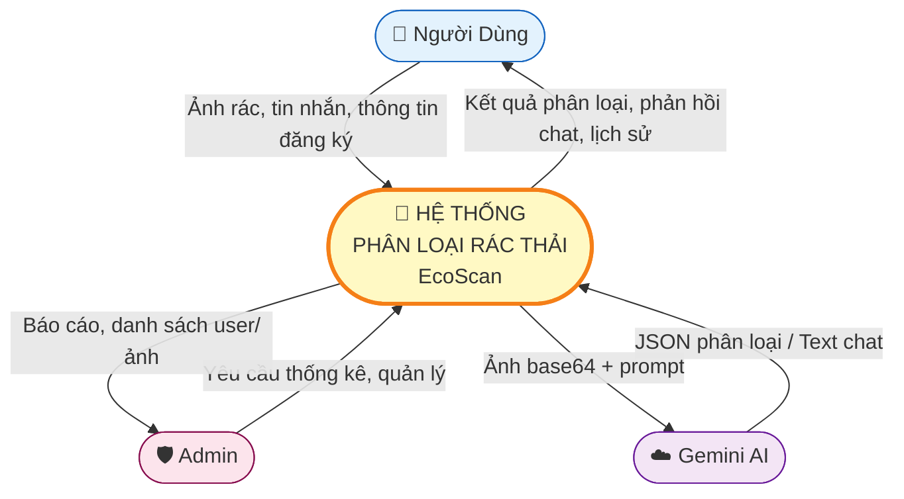
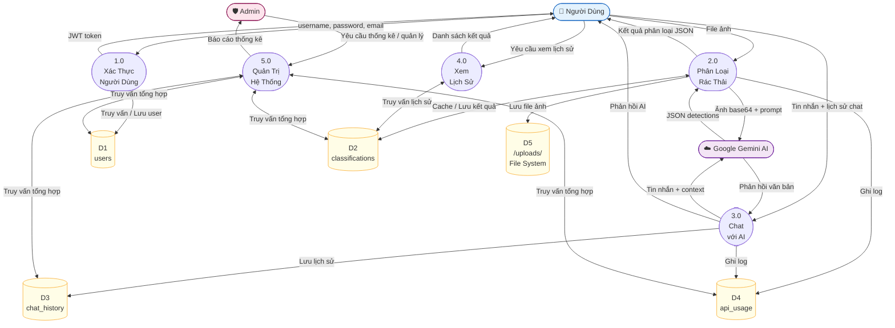
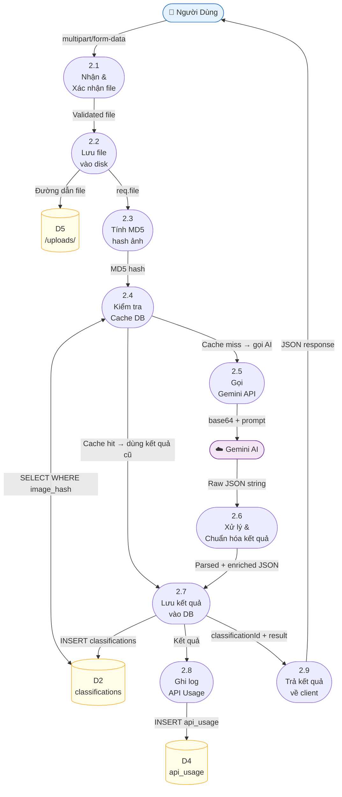

# DFD – Data Flow Diagram
# Hệ Thống Phân Loại Rác Thải Thông Minh (EcoScan)

> Biểu diễn dòng dữ liệu qua các tiến trình xử lý theo chuẩn Yourdon–DeMarco.
> Ký hiệu: `(n)` = Tiến trình, `=====` = Kho dữ liệu, `[ ]` = Tác nhân ngoài

---

## Mức 0 – Context Diagram (Tổng quan)

---

## Mức 1 – DFD Tổng Thể

---

## Mức 2 – Chi Tiết Tiến Trình 2.0: Phân Loại Rác Thải

---

## Mô Tả Các Kho Dữ Liệu (Data Stores)

| Ký hiệu | Tên | Bảng DB | Nội dung |
|---|---|---|---|
| D1 | users | `users` | Thông tin tài khoản, mật khẩu hash, role |
| D2 | classifications | `classifications` | Ảnh đã phân loại, kết quả JSON, hash |
| D3 | chat_history | `chat_history` | Lịch sử câu hỏi và phản hồi AI |
| D4 | api_usage | `api_usage` | Log sử dụng API, token consumed |
| D5 | File System | `/uploads/` | File ảnh gốc upload lên server |

---

## Mô Tả Các Tiến Trình (Processes)

| Tiến trình | Tên | Mô tả |
|---|---|---|
| 1.0 | Xác Thực Người Dùng | Đăng ký, đăng nhập, cấp JWT token |
| 2.0 | Phân Loại Rác Thải | Nhận ảnh → cache → Gemini AI → lưu → trả kết quả |
| 3.0 | Chat với AI | Nhận tin nhắn → Gemini → lưu lịch sử → trả phản hồi |
| 4.0 | Xem Lịch Sử | Lấy danh sách phân loại theo user_id |
| 5.0 | Quản Trị Hệ Thống | Thống kê, quản lý user, quản lý ảnh |
