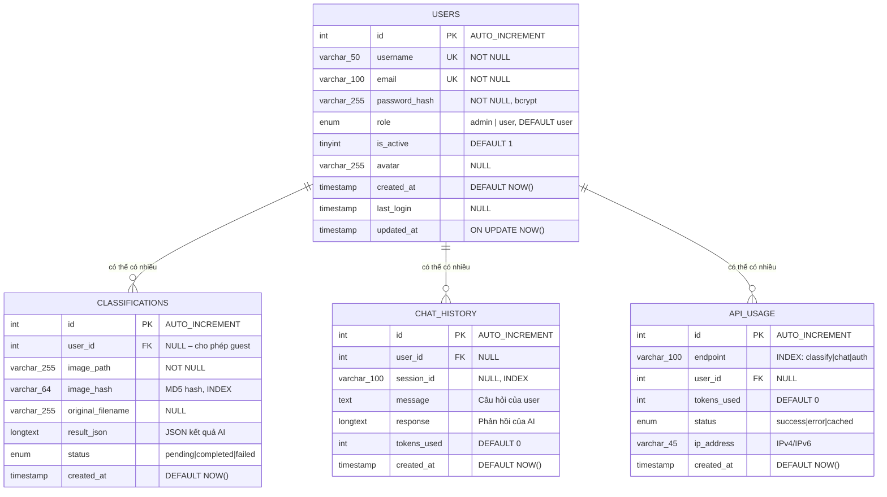

# ERD – Entity Relationship Diagram
# Hệ Thống Phân Loại Rác Thải Thông Minh (EcoScan)

> Mô tả cấu trúc cơ sở dữ liệu MySQL và mối quan hệ giữa các bảng.

---

## Sơ Đồ ERD



---

## Mô Tả Chi Tiết Các Bảng

### Bảng `users` – Người dùng

| Cột | Kiểu | Ràng buộc | Mô tả |
|---|---|---|---|
| `id` | INT | PK, AUTO_INCREMENT | Khóa chính |
| `username` | VARCHAR(50) | UNIQUE, NOT NULL | Tên đăng nhập |
| `email` | VARCHAR(100) | UNIQUE, NOT NULL | Email đăng ký |
| `password_hash` | VARCHAR(255) | NOT NULL | Mật khẩu mã hóa bcrypt |
| `role` | ENUM | DEFAULT 'user' | Phân quyền: admin / user |
| `is_active` | TINYINT(1) | DEFAULT 1 | Trạng thái tài khoản |
| `avatar` | VARCHAR(255) | NULL | Đường dẫn ảnh đại diện |
| `created_at` | TIMESTAMP | DEFAULT NOW() | Ngày tạo tài khoản |
| `last_login` | TIMESTAMP | NULL | Lần đăng nhập cuối |
| `updated_at` | TIMESTAMP | ON UPDATE NOW() | Lần cập nhật cuối |

---

### Bảng `classifications` – Kết quả phân loại

| Cột | Kiểu | Ràng buộc | Mô tả |
|---|---|---|---|
| `id` | INT | PK, AUTO_INCREMENT | Khóa chính |
| `user_id` | INT | FK → users(id), NULL | Người dùng (NULL = khách) |
| `image_path` | VARCHAR(255) | NOT NULL | Đường dẫn file ảnh (`/uploads/...`) |
| `image_hash` | VARCHAR(64) | INDEX | MD5 hash để cache |
| `original_filename` | VARCHAR(255) | NULL | Tên file gốc |
| `result_json` | LONGTEXT | NULL | JSON kết quả từ Gemini AI |
| `status` | ENUM | DEFAULT 'completed' | pending / completed / failed |
| `created_at` | TIMESTAMP | DEFAULT NOW() | Thời gian phân loại |

> **result_json** chứa cấu trúc:
> ```json
> {
>   "detections": [{ "id", "label", "category", "confidence", "color", "boundingBox", "recyclingMethod" }],
>   "summary": "...",
>   "totalItems": 2,
>   "categories": ["organic", "recyclable-plastic"]
> }
> ```

---

### Bảng `chat_history` – Lịch sử chat

| Cột | Kiểu | Ràng buộc | Mô tả |
|---|---|---|---|
| `id` | INT | PK, AUTO_INCREMENT | Khóa chính |
| `user_id` | INT | FK → users(id), NULL | Người dùng |
| `session_id` | VARCHAR(100) | INDEX | ID phiên chat |
| `message` | TEXT | NOT NULL | Câu hỏi của người dùng |
| `response` | LONGTEXT | NOT NULL | Phản hồi từ AI |
| `tokens_used` | INT | DEFAULT 0 | Số token đã dùng |
| `created_at` | TIMESTAMP | DEFAULT NOW() | Thời gian gửi tin |

---

### Bảng `api_usage` – Thống kê sử dụng API

| Cột | Kiểu | Ràng buộc | Mô tả |
|---|---|---|---|
| `id` | INT | PK, AUTO_INCREMENT | Khóa chính |
| `endpoint` | VARCHAR(100) | INDEX | Tên endpoint gọi |
| `user_id` | INT | FK → users(id), NULL | Người dùng |
| `tokens_used` | INT | DEFAULT 0 | Token tiêu thụ |
| `status` | ENUM | DEFAULT 'success' | success / error / cached |
| `ip_address` | VARCHAR(45) | NULL | IP người gọi |
| `created_at` | TIMESTAMP | DEFAULT NOW() | Thời gian gọi |

---

## Mối Quan Hệ (Relationships)

```
users (1) ──────< (N) classifications
  Một user có thể có nhiều kết quả phân loại
  user_id = NULL cho phép khách (guest) phân loại

users (1) ──────< (N) chat_history
  Một user có thể có nhiều lịch sử chat
  user_id = NULL cho phép chat ẩn danh

users (1) ──────< (N) api_usage
  Một user tạo ra nhiều bản ghi log API
  user_id = NULL khi khách gọi API

ON DELETE SET NULL:
  Xóa user → giữ lại dữ liệu, đặt user_id = NULL
```

---

## Indexes

| Bảng | Cột | Loại | Mục đích |
|---|---|---|---|
| `classifications` | `user_id` | INDEX | Lọc theo người dùng |
| `classifications` | `image_hash` | INDEX | Cache lookup nhanh |
| `classifications` | `created_at` | INDEX | Sắp xếp theo thời gian |
| `chat_history` | `user_id` | INDEX | Lọc theo người dùng |
| `chat_history` | `session_id` | INDEX | Nhóm theo phiên chat |
| `api_usage` | `endpoint` | INDEX | Thống kê theo endpoint |
| `users` | `username` | UNIQUE | Đảm bảo không trùng |
| `users` | `email` | UNIQUE | Đảm bảo không trùng |
