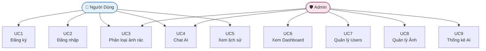

# ĐẶC TẢ HỆ THỐNG
# EcoScan – Hệ Thống Phân Loại Rác Thải Thông Minh

**Phiên bản:** 1.0  
**Ngày:** 2025  
**Loại tài liệu:** Software Requirements Specification (SRS)

---

## 1. Tổng Quan Hệ Thống

### 1.1 Giới Thiệu

EcoScan là hệ thống web ứng dụng trí tuệ nhân tạo (AI) để phân loại rác thải từ ảnh chụp. Người dùng upload ảnh rác lên hệ thống, AI phân tích và trả về loại rác, hướng dẫn tái chế, đồng thời cung cấp chatbot tư vấn môi trường.

### 1.2 Phạm Vi Hệ Thống

| Hạng mục | Chi tiết |
|---|---|
| **Tên hệ thống** | EcoScan – Waste Classifier |
| **Loại ứng dụng** | Web Application (SPA + REST API) |
| **Người dùng** | Cá nhân, học sinh, tổ chức môi trường |
| **Nền tảng** | Web Browser (Desktop & Mobile) |
| **Ngôn ngữ giao diện** | Tiếng Việt |

### 1.3 Công Nghệ Sử Dụng

| Tầng | Công nghệ | Phiên bản |
|---|---|---|
| Frontend | Vue.js 3 + Vite | 3.x |
| Styling | Tailwind CSS | 3.x |
| State Management | Pinia | 2.x |
| Backend | Node.js + Express.js | 18+ / 4.x |
| Database | MySQL (XAMPP) | 8.x |
| AI Service | Google Gemini 1.5 Flash | v1beta |
| Authentication | JWT (jsonwebtoken) | - |
| File Upload | Multer | - |
| Password Hash | bcrypt | - |

---

## 2. Yêu Cầu Chức Năng (Functional Requirements)

### FR-01: Đăng ký tài khoản

| Trường | Nội dung |
|---|---|
| **Mã** | FR-01 |
| **Tên** | Đăng ký tài khoản người dùng |
| **Mô tả** | Người dùng tạo tài khoản mới bằng username, email, mật khẩu |
| **Đầu vào** | username (3-50 ký tự), email hợp lệ, password (≥ 6 ký tự) |
| **Xử lý** | Kiểm tra trùng lặp → mã hóa bcrypt → INSERT users |
| **Đầu ra** | JWT token + thông tin user |
| **Ngoại lệ** | Username/email đã tồn tại → lỗi 400 |

### FR-02: Đăng nhập

| Trường | Nội dung |
|---|---|
| **Mã** | FR-02 |
| **Tên** | Đăng nhập hệ thống |
| **Mô tả** | Người dùng đăng nhập bằng username/email và mật khẩu |
| **Đầu vào** | username hoặc email + password |
| **Xử lý** | Truy vấn user → bcrypt.compare → cấp JWT |
| **Đầu ra** | JWT token (7 ngày), thông tin user |
| **Ngoại lệ** | Sai thông tin → lỗi 401 |

### FR-03: Phân loại rác từ ảnh

| Trường | Nội dung |
|---|---|
| **Mã** | FR-03 |
| **Tên** | Phân loại rác thải bằng AI |
| **Mô tả** | Upload ảnh → AI nhận dạng và phân loại các vật phẩm rác trong ảnh |
| **Đầu vào** | File ảnh (JPG/PNG/WEBP, tối đa 10MB) |
| **Xử lý** | Lưu file → tính hash → kiểm tra cache → gọi Gemini → lưu kết quả |
| **Đầu ra** | Danh sách vật phẩm với: tên, loại, confidence, bounding box, hướng dẫn tái chế |
| **Điều kiện** | Hỗ trợ cả khách (guest) và người dùng đã đăng nhập |
| **Ngoại lệ** | File quá lớn → 400; Gemini lỗi → 500 |

**8 loại rác được nhận dạng:**
- `organic` – Rác hữu cơ
- `recyclable-plastic` – Nhựa tái chế
- `recyclable-paper` – Giấy tái chế
- `recyclable-metal` – Kim loại tái chế
- `recyclable-glass` – Thủy tinh
- `non-recyclable` – Không tái chế
- `hazardous` – Rác nguy hại
- `electronic` – Rác điện tử

### FR-04: Chat AI về môi trường

| Trường | Nội dung |
|---|---|
| **Mã** | FR-04 |
| **Tên** | Chat hỏi đáp với AI |
| **Mô tả** | Người dùng đặt câu hỏi về rác thải, tái chế, môi trường |
| **Đầu vào** | Tin nhắn văn bản + lịch sử chat (tùy chọn) |
| **Xử lý** | Gửi lên Gemini với system instruction chuyên về môi trường Việt Nam |
| **Đầu ra** | Phản hồi tiếng Việt + số token đã dùng |
| **Ngoại lệ** | Rate limit Gemini → thông báo chờ |

### FR-05: Xem lịch sử phân loại

| Trường | Nội dung |
|---|---|
| **Mã** | FR-05 |
| **Tên** | Xem lịch sử phân loại cá nhân |
| **Mô tả** | Người dùng đã đăng nhập xem lại các lần phân loại ảnh trước |
| **Yêu cầu** | Phải đăng nhập |
| **Đầu ra** | Danh sách có phân trang, sắp xếp theo thời gian giảm dần |

### FR-06: Quản trị hệ thống (Admin)

| Trường | Nội dung |
|---|---|
| **Mã** | FR-06 |
| **Tên** | Dashboard quản trị |
| **Mô tả** | Admin xem thống kê, quản lý user, quản lý ảnh phân loại |
| **Yêu cầu** | Phải có role = 'admin' |
| **Tính năng** | Thống kê tổng, danh sách user, danh sách ảnh, thống kê AI |

---

## 3. Yêu Cầu Phi Chức Năng (Non-Functional Requirements)

### NFR-01: Hiệu năng

| Chỉ số | Yêu cầu |
|---|---|
| Phân loại từ cache | < 200ms |
| Phân loại gọi AI mới | < 10 giây |
| Tải trang | < 3 giây (LCP) |
| Concurrent users | Tối thiểu 50 người đồng thời |

### NFR-02: Bảo mật

| Hạng mục | Biện pháp |
|---|---|
| Mật khẩu | bcrypt với salt rounds = 10 |
| Xác thực | JWT, hết hạn sau 7 ngày |
| Upload | Giới hạn loại file (jpg/png/gif/webp), kích thước ≤ 10MB |
| CORS | Chỉ cho phép origin từ `FRONTEND_URL` |
| SQL Injection | Parameterized queries (db.execute với ? placeholder) |

### NFR-03: Khả năng mở rộng

- API phân loại hỗ trợ guest → dễ tích hợp với hệ thống khác
- Cache 2 lớp (memory + DB) giảm chi phí Gemini API
- Cấu trúc route module hóa (auth, classify, chat, history, admin)

### NFR-04: Khả dụng

- Hệ thống chạy trên môi trường local (XAMPP + Node.js)
- Giao diện responsive hỗ trợ Mobile và Desktop
- Thông báo lỗi rõ ràng bằng tiếng Việt

---

## 4. Các Trường Hợp Sử Dụng (Use Cases)

---

## 5. Ràng Buộc Hệ Thống

| Ràng buộc | Mô tả |
|---|---|
| **API Key** | Cần Google Gemini API key hợp lệ từ [aistudio.google.com](https://aistudio.google.com/app/apikey) |
| **Database** | MySQL phải chạy trước khi khởi động backend |
| **Node.js** | Yêu cầu Node.js ≥ 18 |
| **XAMPP** | Apache + MySQL phải đang chạy |
| **Model AI** | Dùng `gemini-1.5-flash` (không phải gemini-pro hay gemini-3.x) |
| **File upload** | Chỉ hỗ trợ JPG, JPEG, PNG, GIF, WEBP |

---

## 6. Giao Diện API (API Endpoints)

| Method | Endpoint | Auth | Mô tả |
|---|---|---|---|
| POST | `/api/auth/register` | Không | Đăng ký tài khoản |
| POST | `/api/auth/login` | Không | Đăng nhập |
| GET | `/api/auth/me` | JWT | Lấy thông tin user hiện tại |
| POST | `/api/classify` | Tùy chọn | Phân loại ảnh rác |
| GET | `/api/classify/:id` | Tùy chọn | Lấy kết quả theo ID |
| POST | `/api/chat` | Tùy chọn | Chat với AI |
| GET | `/api/history` | JWT | Lịch sử phân loại |
| GET | `/api/admin/stats` | JWT Admin | Thống kê tổng |
| GET | `/api/admin/users` | JWT Admin | Danh sách users |
| GET | `/api/admin/images` | JWT Admin | Danh sách ảnh |
| GET | `/api/admin/ai-stats` | JWT Admin | Thống kê AI usage |
