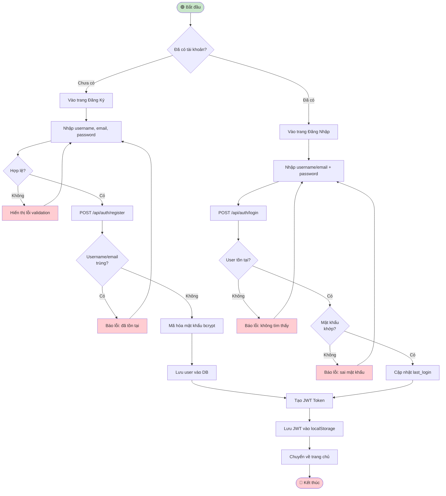
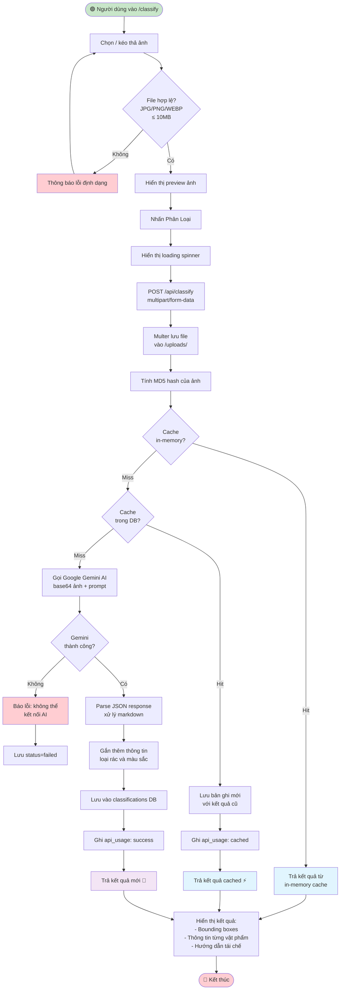
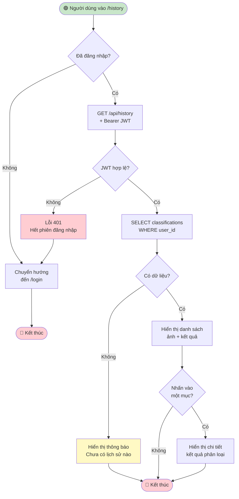
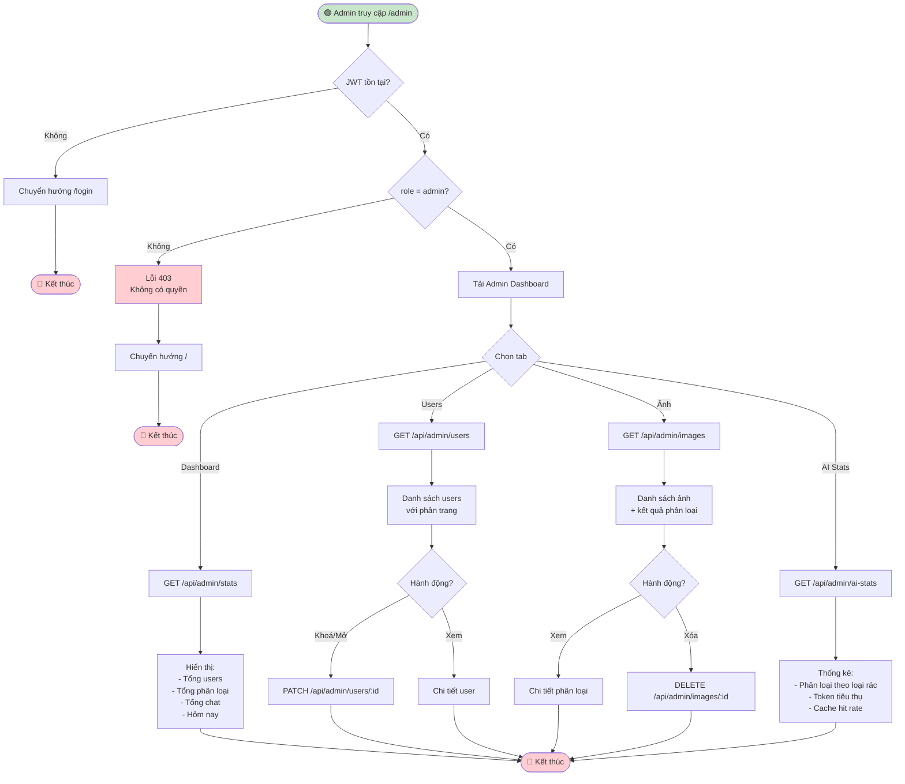

# Sơ Đồ Luồng Hoạt Động (Activity Flow Diagram)
# Hệ Thống Phân Loại Rác Thải Thông Minh (EcoScan)

> Mô tả chi tiết luồng hoạt động của từng tính năng chính theo góc nhìn người dùng.

---

## 1. Luồng Đăng Ký & Đăng Nhập



---

## 2. Luồng Phân Loại Rác Từ Ảnh



---

## 3. Luồng Chat AI

```mermaid
flowchart TD
    START([🟢 Người dùng vào /chat]) --> LOAD_HISTORY[Tải lịch sử chat\ntừ localStorage/DB]
    LOAD_HISTORY --> WELCOME[Hiển thị tin nhắn\nchào mừng từ AI]
    WELCOME --> NHAP_MSG[Người dùng gõ tin nhắn]
    NHAP_MSG --> CHECK_EMPTY{Tin nhắn\nrỗng?}
    CHECK_EMPTY -->|Có| NHAP_MSG
    CHECK_EMPTY -->|Không| SEND_BTN[Nhấn Gửi / Enter]
    SEND_BTN --> SHOW_USER[Hiển thị tin nhắn\nphía người dùng]
    SHOW_USER --> SHOW_TYPING[Hiển thị trạng thái\nAI đang gõ...]
    SHOW_TYPING --> POST_CHAT[POST /api/chat\n{message, history}]
    POST_CHAT --> BUILD_HIST[Xây dựng lịch sử\ntheo định dạng Gemini]
    BUILD_HIST --> CALL_AI[Gọi Gemini AI\nstartChat + sendMessage]
    CALL_AI --> AI_OK{Thành công?}
    AI_OK -->|Không, rate limit| ERR_RATE[Báo lỗi: quá giới hạn\nvui lòng chờ]
    ERR_RATE --> NHAP_MSG
    AI_OK -->|Không, lỗi khác| ERR_AI[Báo lỗi kết nối AI]
    ERR_AI --> NHAP_MSG
    AI_OK -->|Có| SAVE_CHAT[Lưu vào chat_history DB]
    SAVE_CHAT --> RETURN_RESP[Trả về response + tokens]
    RETURN_RESP --> SHOW_AI[Hiển thị phản hồi AI\nvới emoji và định dạng]
    SHOW_AI --> UPDATE_HIST[Cập nhật lịch sử chat\nlocal]
    UPDATE_HIST --> TIEP_TUC{Tiếp tục\nchat?}
    TIEP_TUC -->|Có| NHAP_MSG
    TIEP_TUC -->|Không| END([🔴 Kết thúc])

    style START fill:#C8E6C9
    style END fill:#FFCDD2
    style ERR_RATE fill:#FFCDD2
    style ERR_AI fill:#FFCDD2
    style SHOW_AI fill:#F3E5F5
```

---

## 4. Luồng Xem Lịch Sử



---

## 5. Luồng Quản Trị Admin


